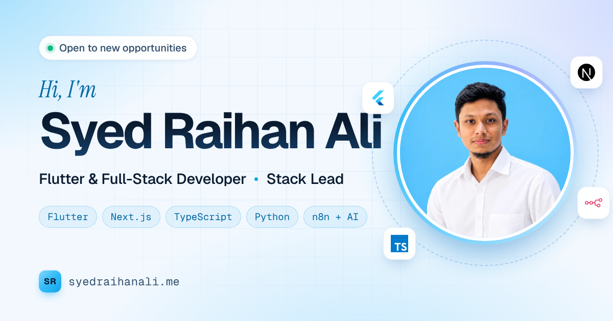

# syedraihanali.me

Personal portfolio of **Syed Raihan Ali** — Flutter & full-stack developer and stack lead at Softvence Agency, based in Dhaka, Bangladesh.

**Live:** <https://syedraihanali.me/>



---

## What's on the page

| Section | Notes |
|---|---|
| Hero | Name, rotating headline, CTAs, live repo count, portrait with orbiting tech icons |
| About | Bio, a "right now" card and four "what I do" services |
| Experience | Animated timeline (Softvence Agency, Bit to Byte) plus education |
| Projects | 4 featured projects with custom visuals, 6 more in a filterable grid, live GitHub stars |
| GitHub activity | Contribution heatmap and stats, fetched live |
| Skills | Six stack groups with icons, plus ways of working |
| Contact | Formspree form (validation, topic chips, spam protection) and direct links |

## Highlights

- **Ice-blue design system** — light "ice" theme by default and a "night sky" dark theme, switched with a circular reveal (View Transitions API). The choice is remembered per visitor.
- **Live data, no backend**
  - The Dhaka Environment Logger card reads the newest reading from the
    [dhaka-environment-logger](https://github.com/syedraihanali/dhaka-environment-logger) CSV on GitHub
    and draws a sparkline for temperature, PM2.5 or humidity.
  - GitHub repos, stars, followers and the 12-month contribution heatmap come from the GitHub REST API and
    [github-contributions-api](https://github-contributions-api.jogruber.de/).
  - Responses are cached in `localStorage`, and the page falls back to built-in snapshot values if a request fails.
- **Motion** — staggered intro, scroll reveals, word rotator, count-up numbers, orbiting icons, cursor spotlight on cards, magnetic buttons, 3D tilt on project visuals, scroll-linked timeline, animated project filtering. Everything respects `prefers-reduced-motion`.
- **Fully responsive** — tested from 360 px phones to wide desktops, with a full-screen mobile menu.
- **Accessible** — semantic landmarks, skip link, visible focus states, labelled form errors, live regions, and WCAG AA colour contrast in both themes.
- **SEO** — meta + Open Graph/Twitter tags, a 1200×630 social card, JSON-LD (`Person`, `WebSite`, `ProfilePage`), sitemap, robots.txt, web manifest and a custom 404 page.

## Tech

Hand-written HTML, CSS and JavaScript. No framework, no build step, no dependencies.

- Fonts: Geist, Geist Mono and Instrument Serif (self-hosted `woff2`)
- Icons: inline SVG sprite for UI icons, colour SVGs for the tech stack

## File structure

```
syedraihanali.github.io/
├── index.html               # The whole page + JSON-LD
├── 404.html                 # Custom "page not found"
├── css/style.css            # Design tokens (light + dark), layout, components, motion
├── js/script.js             # Interactions, live data, contact form
├── assets/
│   ├── CV_Syed_Raihan_Ali.pdf
│   ├── og-image.png         # Social preview (1200×630)
│   ├── favicon.svg, apple-touch-icon.png, icon-*.png
│   ├── fonts/               # Geist, Geist Mono, Instrument Serif
│   ├── icons/               # Tech stack icons
│   └── img/                 # Portrait + project screenshots (WebP)
├── favicon.ico
├── site.webmanifest
├── sitemap.xml
├── robots.txt
└── CNAME                    # syedraihanali.me
```

## Run it locally

No build step. Serve the folder with any static server:

```bash
python3 -m http.server 8000
```

Then open <http://localhost:8000/>.

## Updating content

- **Text, experience, projects** — edit `index.html` directly. Each project is an `<article class="project">`;
  `data-cat` sets its filter (`mobile`, `web`, `auto`) and `data-repo` links it to a GitHub repo for live star counts.
- **Contact form** — posts to Formspree at `https://formspree.io/f/mvkklqgw` (the form's `action` attribute).
- **CV** — replace `assets/CV_Syed_Raihan_Ali.pdf` and keep the file name.
- **Portrait** — replace `assets/img/raihan.webp` (square, 720×720 works well).
- **Colours** — all design tokens live at the top of `css/style.css` (`:root` for light, `:root[data-theme="dark"]` for dark).

## Deployment

GitHub Pages serves the repository root. Push to `main` and the site updates at <https://syedraihanali.me/>.

## Contact

- Email — [syedraihanali65@gmail.com](mailto:syedraihanali65@gmail.com)
- LinkedIn — [in/syedraihanali](https://www.linkedin.com/in/syedraihanali/)
- GitHub — [@syedraihanali](https://github.com/syedraihanali)

## License

MIT for the code. Personal content (photo, CV, project screenshots and text) © Syed Raihan Ali.
